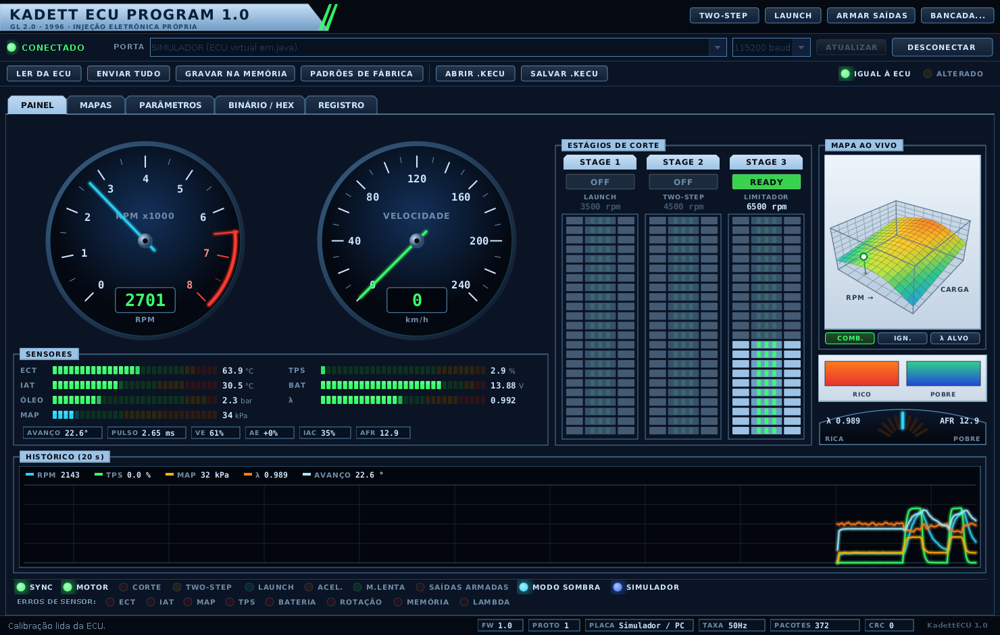
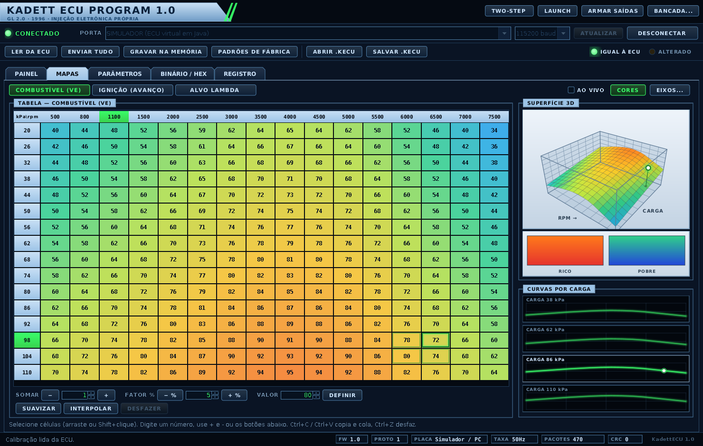
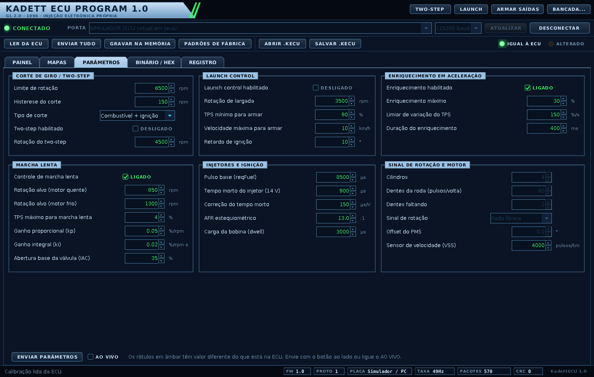
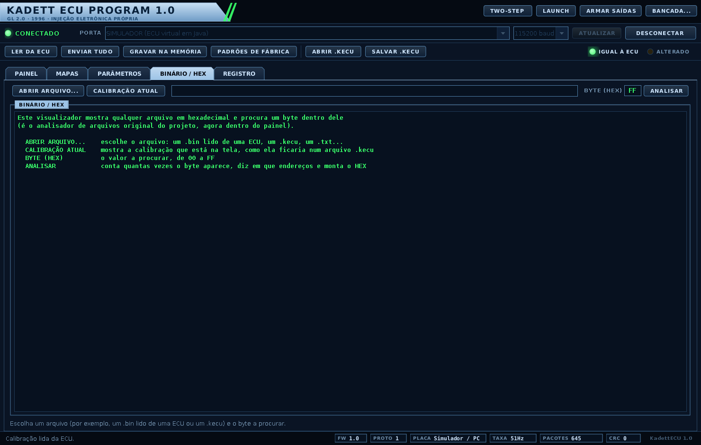

# KadettECU

Projeto de estudo desenvolvido em Java para análise e diagnóstico de ECU.

## Objetivo

Desenvolver uma aplicação para estudar a comunicação e análise de dados de uma ECU automotiva, utilizando o Kadett como projeto de referência.

## Linguagem

- Java
  
## Status

🚧 Em desenvolvimento

## Projeto

Este projeto faz parte dos meus estudos em programação e tem como objetivo unir desenvolvimento de software com conhecimentos de eletrônica e sistemas automotivos.

---

## O que há no projeto agora

O projeto cresceu e virou a base de um sistema de gerenciamento de injeção eletrônica para um **Kadett GL 2.0 1996**: um aplicativo de desktop no notebook conversa, por USB, com uma placa (ESP32 ou Arduino Mega 2560) que roda o firmware. O aplicativo mostra os dados do motor em tempo real e edita a calibração; o firmware lê os sensores, calcula o pulso do bico e o avanço da ignição e, quando estiver armado, comanda bicos e bobina.

| Parte | Onde | O que faz |
|---|---|---|
| Aplicativo (Java, Swing) | `src/main/java/kadettecu/` | painel de instrumentos em tempo real (rotação, velocidade, temperatura da água, MAP, pressão do óleo, TPS, lambda/AFR, bateria), editor de mapas 16×16 em 2D e 3D (combustível, ignição, lambda-alvo), parâmetros (limitador de rotação, two-step, launch control, enriquecimento de aceleração, marcha lenta, injetores, roda fônica), registro de eventos, bancada de testes e o analisador de binário original |
| Comunicação | `comunicacao/`, `protocolo/` | porta serial USB (biblioteca jSerialComm) lida em threads separadas, para a janela nunca congelar; protocolo binário com CRC-16 |
| Simulador | `simulador/` | uma ECU e um carro virtuais em Java: dá para usar o aplicativo inteiro sem placa |
| Firmware (C e C++) | `firmware/` | núcleo em C (leitura da roda fônica, planejador de ignição e injeção, limitador, two-step, launch control, enriquecimento, marcha lenta, protocolo, memória permanente), código para ESP32 e Arduino Mega 2560, e o **mesmo núcleo rodando no PC**, para testar |
| Documentação | `docs/` | o que foi feito e por quê, o protocolo e o guia de hardware (veja [Documentação](#documentação)) |

| | |
|---|---|
|  |  |
|  |  |

*(Telas geradas com o simulador.)*

## ⚠️ Antes de ligar em um carro

> Tudo foi testado **em software** (no PC, com simuladores). O código das placas **nunca foi compilado com as ferramentas reais** do ESP32 e do Arduino, nunca rodou em uma placa, e **nada** foi testado com motor, sensor, bico ou bobina de verdade.
>
> O firmware vem em **modo sombra**: nenhum pino de saída é ligado. Bico e bobina só são acionados se o firmware for compilado com as saídas **e** o aplicativo armar a ECU. Comece pela bancada, siga o roteiro do [`docs/HARDWARE.md`](docs/HARDWARE.md) e, no carro, só leitura, com a ECU original ainda no comando. Modificar a injeção de um carro pode afetar emissões, garantia, seguro e a legislação de trânsito.

## Como rodar

Precisa do **JDK 11 ou mais novo** (foi testado com o 21). O firmware no PC precisa também de `gcc` e `make`; as placas, do PlatformIO. No Windows, use os `.bat` com o mesmo nome (eles foram escritos no Linux e **nunca foram executados no Windows**).

### Sem placa nenhuma: o simulador em Java

```bash
./compilar.sh                # compila o aplicativo (só com o JDK, sem Maven)
./executar.sh --simulador    # abre o painel já ligado a uma ECU virtual
```

O carro virtual faz sozinho um ciclo de aceleração. O botão `BANCADA...` abre os controles para fixar rotação, acelerador e sensores à mão. Sem o `--simulador`, o `./executar.sh` abre o painel desligado: escolha uma porta na barra de conexão e clique em `CONECTAR`.

### O firmware em C rodando no PC

```bash
make -C firmware/host        # gera firmware/host/build/ecu_host (precisa de gcc e make)
./executar.sh
```

Na lista de portas escolha `FIRMWARE C (PC) - o mesmo código da placa`. É o código C que vai para a placa, só que rodando no seu computador.

### Com uma placa de verdade (ESP32 ou Arduino Mega 2560)

```bash
pip install platformio
cd firmware
pio run -e esp32dev -t upload          # ESP32, em modo sombra
pio run -e megaatmega2560 -t upload    # Arduino Mega 2560, em modo sombra
```

Depois abra o aplicativo, escolha a porta USB (115200) e clique em `CONECTAR`. A serial é binária: **não** use o monitor serial. A ligação elétrica, os sensores, o estágio de potência e o roteiro de teste e de calibração estão no [`docs/HARDWARE.md`](docs/HARDWARE.md).

### O analisador de binário original

```bash
./executar.sh --legado       # a janela e o menu no console, como o programa era antes
./executar.sh --console      # só o menu no console
```

O mesmo analisador também está na aba `BINÁRIO / HEX` do painel. Os arquivos de exemplo `Teste.txt` e `Teste2.txt` do projeto original ficam uma pasta acima do repositório.

### Maven (opcional)

O `pom.xml` serve a quem prefere Maven ou quer importar o projeto numa IDE (`mvn package`; `mvn -Ptestes test` roda os testes). Ele **nunca foi executado**: o caminho que foi testado de verdade é o do `compilar.sh`.

## Testes

```bash
./testar.sh              # o núcleo em C, o código das placas e os 5 programas de teste em Java
./testar.sh sanitize     # o mesmo, mais os testes em C com AddressSanitizer e UBSan
```

Precisa de JDK, `gcc`, `g++` e `make` (e do `xvfb-run` se não houver tela). Os testes em Java são programas com `main`, no estilo do `TesteKadettECU` original, e terminam com código de saída 1 se alguma verificação falhar. Um teste que não encontra o que precisa (tela, `gcc`, Linux/macOS e Python 3 para o `TesteSerialReal`) **avisa e se declara ignorado**; um teste ignorado não é um teste aprovado, então confira a saída. O que cada teste exercita, e o que eles **não** provam, está em [`docs/EXPLICACAO.md`](docs/EXPLICACAO.md) (seção 9).

## Estrutura das pastas

```
├── README.md
├── pom.xml                          Maven (opcional)
├── compilar.sh / .bat               compilar só com o JDK
├── executar.sh / .bat               abrir o aplicativo
├── testar.sh   / .bat               rodar os testes
├── libs/                            jSerialComm 2.11.0 (a única biblioteca de terceiros)
├── src/main/java/kadettecu/
│   ├── Inicio.java                  ponto de entrada (era o inicio.java)
│   ├── analise/                     as classes originais do projeto (+ RelatorioHex)
│   ├── protocolo/  modelo/          os bytes da serial e os dados do motor
│   ├── comunicacao/  app/           a conexão com a placa e a sessão de trabalho
│   ├── simulador/                   ECU e carro virtuais
│   └── ui/                          janelas, painéis e gráficos
├── src/test/java/kadettecu/teste/   os programas de teste
├── firmware/
│   ├── lib/                         núcleo em C e agendador das saídas
│   ├── src/                         main.cpp e a HAL do ESP32 e do Mega
│   ├── platformio.ini               4 ambientes de compilação
│   └── host/  mock/  teste_placas/  o núcleo no PC e os testes
└── docs/                            documentação, imagens e exemplos
```

## Documentação

| Documento | O que tem |
|---|---|
| [`docs/EXPLICACAO.md`](docs/EXPLICACAO.md) | o que mudou nos arquivos existentes e o que foi acrescentado, a arquitetura, **por que** cada API, biblioteca e estrutura de threads, os testes e os limites |
| [`docs/PROTOCOLO.md`](docs/PROTOCOLO.md) | o formato exato dos bytes entre o notebook e a placa |
| [`docs/HARDWARE.md`](docs/HARDWARE.md) | ligar a placa ao Kadett: segurança, pinagem, sensores, bicos, bobina, compilar e gravar, teste de bancada e calibração |

## O que ainda não foi validado

Compilar com as cadeias reais do ESP32 e do Arduino; rodar nas placas; sensores, bicos, bobina e motor de verdade; a sincronia com a roda fônica do Kadett (e até o tipo de injeção do carro, que precisa ser confirmado nele); o Windows e o macOS. A lista completa, com como validar cada item, é a seção 14 do [`docs/HARDWARE.md`](docs/HARDWARE.md).

## Bibliotecas de terceiros

[jSerialComm](https://github.com/Fazecast/jSerialComm) 2.11.0 (Fazecast), em `libs/`, sob licença dupla Apache 2.0 ou LGPL 3.0. Detalhes em [`libs/LEIA-ME.txt`](libs/LEIA-ME.txt).
