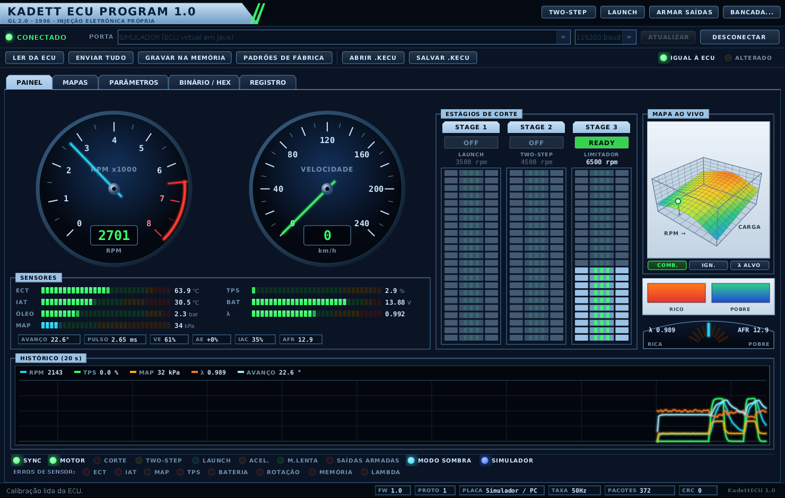
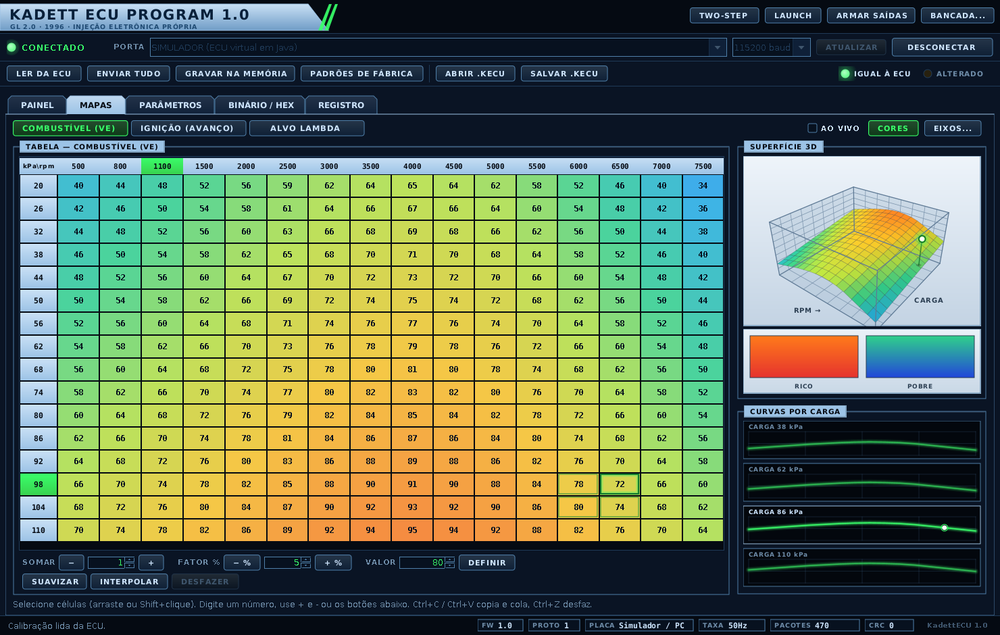
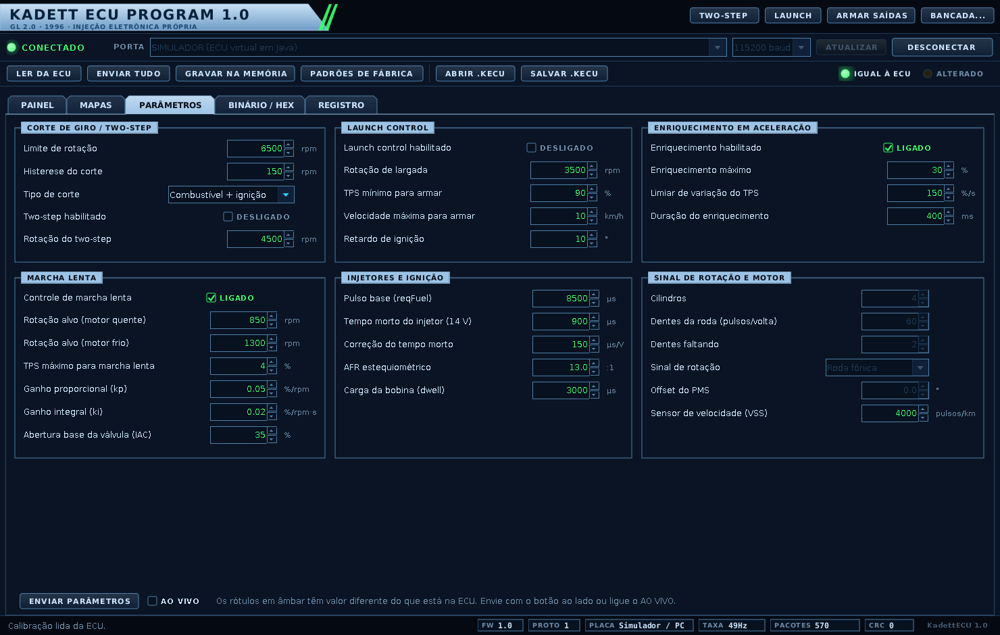
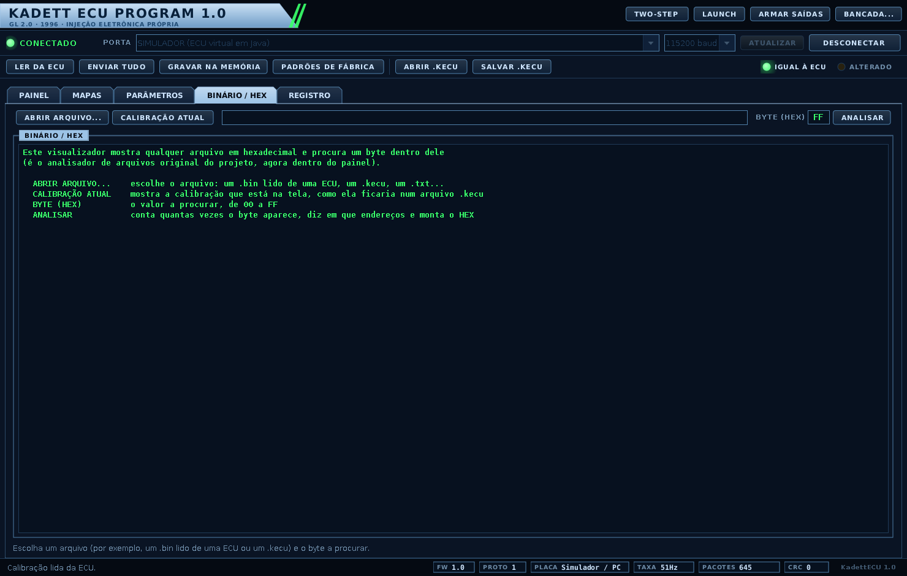

# KadettECU — o que foi feito, onde foi feito e por quê

Este documento conta o que foi feito em cima do **seu** projeto KadettECU (o zip que você enviou): o que já existia e foi mantido, o que mudou nos arquivos existentes, o que foi acrescentado e **por que** cada API, biblioteca e estrutura de threads do Java foi escolhida. A ideia é que você consiga explicar cada decisão (numa entrevista, num trabalho da faculdade) e mexer no código sem medo.

Os outros documentos do projeto:

| Documento | Para que serve |
|---|---|
| [`README.md`](../README.md) | começar rápido: compilar, abrir, testar |
| **`docs/EXPLICACAO.md`** (este) | o que mudou, a arquitetura, as threads, as APIs, os testes e os limites |
| [`docs/PROTOCOLO.md`](PROTOCOLO.md) | o formato exato dos bytes entre o notebook e a placa |
| [`docs/HARDWARE.md`](HARDWARE.md) | ligar a placa ao Kadett: segurança, sinais, bicos, bobina, calibração |

> **Leia antes de ligar em um carro.** Tudo foi testado **em software** (no PC, com simuladores). O código das placas **nunca foi compilado com as ferramentas reais** (ESP32 e Arduino) nem rodou em hardware, e nada foi testado com motor, bico ou bobina de verdade. A [seção 10](#10-limites-e-o-que-ainda-precisa-ser-validado) lista o que ainda precisa de validação, e o [`HARDWARE.md`](HARDWARE.md) traz o roteiro seguro para fazer isso.

## Sumário

1. [Resumo em uma página](#1-resumo-em-uma-página)
2. [O que já existia e o que mudou](#2-o-que-já-existia-e-o-que-mudou)
3. [A arquitetura em camadas](#3-a-arquitetura-em-camadas)
4. [Pacote por pacote](#4-pacote-por-pacote)
5. [As threads: quem roda onde](#5-as-threads-quem-roda-onde)
6. [Por que cada API e biblioteca](#6-por-que-cada-api-e-biblioteca)
7. [A POO que você pode ver no código](#7-a-poo-que-você-pode-ver-no-código)
8. [O firmware em C](#8-o-firmware-em-c)
9. [Como foi testado](#9-como-foi-testado)
10. [Limites e o que ainda precisa ser validado](#10-limites-e-o-que-ainda-precisa-ser-validado)
11. [Como colocar no seu repositório Git](#11-como-colocar-no-seu-repositório-git)
12. [Para onde ir agora](#12-para-onde-ir-agora)
13. [Fontes](#13-fontes)

---

## 1. Resumo em uma página

### O que você tem agora

| Parte | Onde | Tamanho | O que faz |
|---|---|---|---|
| Aplicativo Java (Swing) | `src/main/java/kadettecu/` | ≈ 11,9 mil linhas | painel de instrumentos, editores de mapas 2D e 3D, parâmetros, analisador de binário (o seu), registro e bancada de testes |
| Simulador de ECU em Java | `kadettecu/simulador/` | ≈ 0,8 mil linhas | uma ECU e um carro virtuais, para usar o aplicativo sem placa |
| Firmware em C: núcleo e agendador | `firmware/lib/` | ≈ 2,6 mil linhas | rotação, limitador, two-step, launch, enriquecimento, marcha lenta, pulso e avanço, protocolo, memória |
| Código das placas (C++) | `firmware/src/` | ≈ 0,8 mil linhas | liga o núcleo ao ESP32 e ao Arduino Mega 2560 |
| Firmware no PC e simuladores das placas | `firmware/host/`, `firmware/mock/`, `firmware/teste_placas/` | ≈ 8,4 mil linhas | roda o **mesmo** núcleo no PC e testa o código das placas sem as placas |
| Documentação | `docs/` | 3 documentos + imagens | este texto, o protocolo e o guia de hardware |

### Quatro jeitos de rodar o mesmo aplicativo

| Modo | Como abrir | O que precisa |
|---|---|---|
| Simulador em Java | `./executar.sh --simulador` | só o JDK |
| Firmware em C rodando no PC | `make -C firmware/host` e, no aplicativo, escolher `FIRMWARE C (PC)` na lista de portas | JDK, `gcc` e `make` |
| Placa de verdade (ESP32 ou Mega) | gravar com o PlatformIO e escolher a porta USB na lista | a placa (comece pelo modo sombra: [`HARDWARE.md`](HARDWARE.md)) |
| O seu analisador de binário original | `./executar.sh --legado` (janela + console) ou `--console` | só o JDK |

No Windows use `executar.bat` (os `.bat` não foram testados no Windows: foram escritos no Linux).

### O que está provado e o que não está

- **Provado por teste automático** (software): o protocolo (CRC, quadros partidos, ruído), os 3 caminhos de comunicação (simulador, firmware em C no PC e uma porta serial de verdade do sistema operacional), o comportamento do núcleo em C (limitador, two-step, launch, ignição, injeção, memória), o código das duas placas contra simuladores das bibliotecas Arduino/ESP32, e a interface (a janela abre, conecta e responde aos controles).
- **Não provado** (precisa de hardware ou de ferramentas que não havia aqui): compilar com o `xtensa-gcc` e o `avr-gcc` reais, rodar numa placa, ler sensores reais, comandar bico e bobina, a sincronia com a roda fônica do Kadett. Os detalhes estão na [seção 10](#10-limites-e-o-que-ainda-precisa-ser-validado).

---

## 2. O que já existia e o que mudou

### 2.1 A regra que você deu

Você pediu para **não criar um projeto novo do zero**, e sim trabalhar em cima da estrutura existente. Foi o que aconteceu: as dez classes do seu projeto continuam todas lá, com o mesmo código. Nada foi apagado. O que mudou nelas está inteiro na tabela abaixo.

### 2.2 Mapa: arquivo original → onde está agora

| Original (no seu zip) | Agora | O que mudou |
|---|---|---|
| `AnalisadorECU.java` | `src/main/java/kadettecu/analise/AnalisadorECU.java` | **só** a linha `package kadettecu.analise;` no topo |
| `ArquivoECU.java` | `…/analise/ArquivoECU.java` | idem |
| `ControladorECU.java` | `…/analise/ControladorECU.java` | idem |
| `ExibidorResultado.java` | `…/analise/ExibidorResultado.java` | idem |
| `InterfaceConsole.java` | `…/analise/InterfaceConsole.java` | idem |
| `LinhaHex.java` | `…/analise/LinhaHex.java` | idem |
| `ResultadoAnalise.java` | `…/analise/ResultadoAnalise.java` | idem |
| `JanelaPrincipal.java` | `…/analise/JanelaPrincipal.java` | `package`; classe `final`; campo `transient`; o método `montarRelatorio` saiu para a classe nova `RelatorioHex` ([2.4](#24-janelaprincipal-o-que-mudou-e-por-quê)) |
| `inicio.java` | `src/main/java/kadettecu/Inicio.java` | renomeada (inicial maiúscula, como manda a convenção do Java) e com mais modos; o que ela fazia antes é o modo `--legado` ([2.5](#25-iniciojava-o-comportamento-antigo-continua-existindo)) |
| `TesteKadettECU.java` | `src/test/java/kadettecu/teste/TesteKadettECU.java` | `package` e `import`s; as verificações originais continuam; foram acrescentadas 4 ([2.6](#26-testekadettecujava)) |
| `README.md` | `README.md` | o texto original foi mantido; entraram as seções novas |
| `Teste.txt`, `Teste2.txt` | iguais, **uma pasta acima** do projeto, como no seu zip | nada |
| — (novo) | `…/analise/RelatorioHex.java` | extraída de `JanelaPrincipal` |

> **Como isso foi conferido**: comparei cada classe original com a atual (ignorando o fim de linha CRLF/LF). As sete primeiras diferem **apenas** pela linha `package kadettecu.analise;` acrescentada no topo (em seis delas, mais uma linha em branco depois). A conferência é refeita sobre o zip final, no passo de empacotamento.

### 2.3 Por que a linha `package`

Sem `package`, uma classe Java fica no "pacote sem nome". O problema é que **uma classe de um pacote com nome não consegue importar uma classe do pacote sem nome** (é erro de compilação: JLS §7.5 [F1]). O projeto agora tem vários pacotes (`ui`, `app`, `comunicacao`…), e a aba `BINÁRIO / HEX` da janela nova (que fica em `ui`) reaproveita as **suas** classes `ControladorECU`, `ArquivoECU` e `RelatorioHex`. Para isso elas precisaram entrar num pacote: `kadettecu.analise`.

A segunda razão é a estrutura de pastas. O padrão do Java (e do Maven, e do que o IntelliJ e o Eclipse esperam) é a pasta bater com o pacote: `kadettecu.analise.AnalisadorECU` mora em `src/main/java/kadettecu/analise/AnalisadorECU.java`.

### 2.4 `JanelaPrincipal`: o que mudou e por quê

São três mudanças, nesta ordem no diff:

```diff
+package kadettecu.analise;
+
...
-public class JanelaPrincipal extends JFrame implements ExibidorResultado {
+public final class JanelaPrincipal extends JFrame implements ExibidorResultado {
...
-    private final ControladorECU controlador;
+    private final transient ControladorECU controlador; // transient: o JFrame é Serializable, o controlador não
...
-        areaTexto.append(montarRelatorio(resultado));
-    }
-
-    private String montarRelatorio(ResultadoAnalise resultado) {
-        ... (28 linhas que montam o texto do relatório)
+        areaTexto.append(RelatorioHex.montar(resultado));
```

1. **`final` e `transient`**. Compilei a sua versão original com `javac -Xlint:all` (o JDK 21 que usei aqui) e ela dá **3 avisos**: um de serialização (`JFrame` é `Serializable`, mas o campo `controlador` não) e dois de `this-escape` (o construtor chama métodos que uma subclasse poderia sobrescrever). `transient` resolve o primeiro e `final` (ninguém herda de `JanelaPrincipal`) resolve os outros dois. O comportamento não muda. O projeto compila com `-Xlint:all` para que esses avisos apareçam e não se acumulem.
2. **O relatório saiu para `RelatorioHex`**. A janela antiga montava o texto do relatório (a lista de ocorrências e o HEX viewer) dentro dela mesma. A aba `BINÁRIO / HEX` da janela nova precisa **do mesmo texto**. Em vez de copiar as 28 linhas, elas foram movidas para `RelatorioHex.montar(ResultadoAnalise)` e as duas telas chamam a mesma coisa. Isso também separa as responsabilidades: a janela **mostra**, o `RelatorioHex` **formata**, o `AnalisadorECU` **analisa**.
3. **Garantia de que o texto não mudou**: o `TesteKadettECU` guarda uma cópia fiel do método antigo (`relatorioOriginal`) e confere que o `RelatorioHex` produz exatamente o mesmo texto, com ocorrências, sem ocorrências e com um arquivo binário maior.

### 2.5 `Inicio.java`: o comportamento antigo continua existindo

O seu `inicio.java` tinha 17 linhas: imprimia o nome e a versão, criava o controlador, a janela e o console, ligava os dois ao controlador e abria tudo. Isso agora está no método `iniciarLegado()` do `Inicio.java`, com as mesmas linhas, e é o que `./executar.sh --legado` faz. O que há de novo é uma escolha de modo logo no `main`:

| Argumento | O que abre |
|---|---|
| (nenhum) | o painel completo (instrumentos, mapas, parâmetros, binário, registro) |
| `--simulador` | o painel já conectado ao simulador em Java |
| `--legado` | **o que o programa fazia antes**: a janela do analisador + o menu no console |
| `--console` | só o analisador no console |
| `--ajuda` (ou qualquer outra coisa) | explica os modos |

A classe passou a se chamar `Inicio` porque, em Java, o nome do arquivo precisa ser igual ao da classe pública e, por convenção, classes começam com letra maiúscula. A única diferença visível no modo legado é o número de versão impresso (antes "0.1", agora o da janela nova).

### 2.6 `TesteKadettECU.java`

O seu teste continua sendo um programa com `main` (sem JUnit), no mesmo estilo (`verificar("descrição", condição)`). Mudou: a linha `package`, os `import`s necessários (as classes agora estão em outro pacote) e foram **acrescentados** o método `testarRelatorioHex()` e a cópia de referência `relatorioOriginal()`. As verificações que você já tinha (`LinhaHex`, `AnalisadorECU`, `ControladorECU`, incluindo as de encapsulamento e polimorfismo) estão intactas, e passam.

Todos os testes novos do projeto seguem esse mesmo estilo de propósito: não precisam baixar nada, rodam com `java` puro e terminam com código de saída 1 se alguma verificação falhar (então servem em scripts).

### 2.7 `README.md`

O texto original (Objetivo, Linguagem, Status, Projeto) foi mantido como está e as seções novas foram acrescentadas depois dele.

### 2.8 A estrutura de pastas

```
KadettECU/                           ← a pasta mais interna do seu zip (a que tem o .git)
├── README.md                        ← o seu README + as seções novas
├── pom.xml                          ← Maven (opcional; veja a seção 6)
├── compilar.sh / compilar.bat       ← compilar só com o JDK
├── executar.sh / executar.bat       ← abrir o aplicativo
├── testar.sh   / testar.bat         ← rodar todos os testes
├── libs/                            ← jSerialComm 2.11.0 (a única biblioteca de terceiros)
├── src/main/java/kadettecu/
│   ├── Inicio.java                  ← era o inicio.java
│   ├── analise/                     ← as suas classes originais (+ RelatorioHex)
│   ├── protocolo/                   ← quadros, CRC, decodificador
│   ├── modelo/                      ← telemetria, parâmetros, mapas, calibração
│   ├── comunicacao/                 ← ConexaoECU e as portas (USB, simulada, processo)
│   ├── simulador/                   ← ECU e carro virtuais
│   ├── app/                         ← SessaoECU, opções de porta, bancada
│   └── ui/                          ← janelas, painéis, gráficos, tema
├── src/test/java/kadettecu/teste/   ← TesteKadettECU (o seu) + 4 testes novos
├── firmware/
│   ├── lib/kecu_core/               ← núcleo em C (o que roda na placa)
│   ├── lib/kecu_sched/              ← agendador de bordas das saídas
│   ├── src/                         ← main.cpp + HAL do ESP32 e do Mega
│   ├── platformio.ini               ← 4 ambientes de compilação
│   ├── host/                        ← o mesmo núcleo rodando no PC (ecu_host) + testes
│   ├── mock/                        ← simuladores das bibliotecas Arduino e ESP32
│   └── teste_placas/                ← testes do código das placas + teste de mutação
└── docs/                            ← EXPLICACAO.md, PROTOCOLO.md, HARDWARE.md, imagens/, exemplos/
```

Fora do repositório, uma pasta acima, ficam os seus `Teste.txt` e `Teste2.txt` (arquivos de exemplo para a aba `BINÁRIO / HEX`), como já estavam no seu zip.

---

## 3. A arquitetura em camadas

### 3.1 O desenho

```
┌───────────────────────── Swing: a thread de eventos (EDT) ──────────────────────────┐
│ JanelaECU  →  PainelInstrumentos │ PainelMapas │ PainelParametros │ PainelBinario │ PainelRegistro
│ BarraConexao · BarraCalibracao · ComandosECU · JanelaBancada            (pacote ui)  │
└──────────────────────────────────────┬──────────────────────────────────────────────┘
                                       │ chama métodos que devolvem CompletableFuture
┌──────────────────────────────────────▼──────────────────────────────────────────────┐
│ SessaoECU (pacote app): a calibração em edição, "igual à ECU / alterado", as operações│
└──────────────────────────────────────┬──────────────────────────────────────────────┘
                                       │ conexao.emSegundoPlano(...)
┌──────────────────────────────────────▼──────────────────────────────────────────────┐
│ ConexaoECU (pacote comunicacao): threads rx / tx / tarefas / vigia, tentativas, CRC   │
└──────────────────────────────────────┬──────────────────────────────────────────────┘
                                       │ interface PortaSerial
       ┌───────────────────────────────┼─────────────────────────────────┐
 PortaJSerialComm                 PortaProcesso                     PortaSimulada
 (USB de verdade,                 (o firmware em C rodando          (o SimuladorECU em Java,
  biblioteca jSerialComm)          no PC: ecu_host)                  dentro do programa)

 Embaixo de tudo, usados por várias camadas:  protocolo (Pacote, Crc16, DecodificadorPacotes…)
                                              modelo    (Telemetria, ParametrosMotor, MapaECU, Calibracao…)
```

### 3.2 A regra que mantém a casa em ordem

**As setas só descem.** A tela conhece a sessão, a sessão conhece a conexão, a conexão conhece a porta; **nada conhece quem está acima dele**. Isso foi conferido no código: nenhuma classe de `protocolo`, `modelo`, `comunicacao`, `simulador` ou `app` importa `javax.swing` ou `java.awt`. Só o pacote `ui`, a sua `JanelaPrincipal` e o `Inicio` importam.

O ganho prático:

- o protocolo, a conexão e o simulador são testados **sem tela** (o `TesteSistema` roda em qualquer máquina, até num servidor sem monitor);
- trocar a interface (uma versão web, JavaFX…) não mexe em nada da comunicação;
- trocar o "fio" (USB, simulador, programa em C) não mexe em nada da interface.

### 3.3 As duas costuras

Há dois pontos onde o código foi feito para ser **trocado de lugar** sem mudar o resto:

1. **`PortaSerial`** (uma `interface`): a `ConexaoECU` só sabe "ler bytes, escrever bytes, abrir, fechar". Por trás dela pode estar a porta USB real, o simulador ou o firmware em C. É por isso que o mesmo aplicativo funciona sem placa e que o firmware pôde ser testado pelo próprio programa Java.
2. **O `Executor tela`** que a `SessaoECU` recebe no construtor: é "a maneira de voltar para a thread da tela". No programa é `SwingUtilities::invokeLater`; nos testes é `Runnable::run` (executa na hora, na mesma thread). Assim a `SessaoECU` nunca precisou importar o Swing.

---

## 4. Pacote por pacote

Linhas de código por pacote (somente `src/main/java`): `ui` 6 963 · `modelo` 1 216 · `comunicacao` 1 169 · `simulador` 842 · `app` 809 · `analise` 396 · `protocolo` 369 · `Inicio` 96 (total 11 860).

### 4.1 `analise`: o seu código original

| Classe | Papel |
|---|---|
| `ArquivoECU` | representa o arquivo (caminho, existência, tamanho) |
| `AnalisadorECU` | lê o arquivo, procura as ocorrências de um byte e divide o conteúdo em linhas de 16 bytes |
| `LinhaHex` | uma linha do HEX viewer (endereço, bytes, coluna ASCII) |
| `ResultadoAnalise` | o resultado: endereços achados, linhas, quantidade de bytes |
| `ExibidorResultado` | `interface`: "alguém que sabe mostrar um resultado" |
| `ControladorECU` | liga tudo: recebe o pedido, analisa, avisa todos os exibidores |
| `InterfaceConsole` | exibidor + menu no console |
| `JanelaPrincipal` | exibidor em janela Swing (a janela original) |
| `RelatorioHex` | **novo**: monta o texto do relatório (veja [2.4](#24-janelaprincipal-o-que-mudou-e-por-quê)) |

### 4.2 `protocolo`: os bytes entre o notebook e a placa

| Classe | Papel |
|---|---|
| `Protocolo` | as constantes do protocolo: comandos, respostas, códigos de recusa (NACK), bits de estado e de erro. É o [`PROTOCOLO.md`](PROTOCOLO.md) escrito em código; o firmware usa os mesmos valores |
| `Pacote` | um quadro, **imutável**: tipo, número de sequência e payload. `codificar()` gera `A5 5A · LEN · TIPO · SEQ · payload · CRC16` |
| `Crc16` | CRC-16/CCITT-FALSE; o teste confere o valor padrão: `"123456789"` dá `0x29B1` |
| `DecodificadorPacotes` | transforma o fluxo de bytes da serial em quadros. Tolera ruído, quadros partidos em vários blocos e quadros colados; se o CRC falha, procura o próximo início de quadro |
| `BufferLE` | lê e escreve inteiros em *little-endian* (o formato do protocolo) |

Por que binário e com CRC, e não texto? Cada telemetria tem 43 bytes (5 de cabeçalho, 36 de dados e 2 de CRC); a 50 quadros por segundo isso ocupa ≈ 19 % de uma linha de 115 200 baud, o que seria bem mais com texto. E num carro **há ruído elétrico** (a bobina de ignição é uma fonte clássica): o CRC deixa o aplicativo descartar um quadro corrompido em vez de mostrar um número errado. O detalhamento está no [`PROTOCOLO.md`](PROTOCOLO.md).

### 4.3 `modelo`: os dados do motor

| Classe | Papel |
|---|---|
| `Telemetria` | um instantâneo do motor (rotação, velocidade, ECT, IAT, MAP, óleo, TPS, lambda, bateria, avanço, pulso, flags, erros…), **imutável**, 36 bytes na serial |
| `CampoParametro` | `enum` com os **32 parâmetros** ajustáveis (limite de giro, two-step, launch, enriquecimento, marcha lenta, injetores, roda fônica…), cada um com faixa, unidade, valor de fábrica e se só pode mudar com o motor parado |
| `ParametrosMotor` | os valores desses parâmetros, validados pela faixa |
| `TipoMapa` | `enum` das 3 tabelas: `COMBUSTIVEL` (VE em %), `IGNICAO` (avanço em °), `ALVO_LAMBDA`; sabe converter o byte da tabela para a grandeza física |
| `MapaECU` | uma tabela 16 × 16 de bytes, com operações de edição |
| `EixosMapa` | os eixos comuns às três tabelas: 16 rotações (colunas) e 16 cargas em kPa (linhas) |
| `Calibracao` | o conjunto completo (parâmetros + eixos + 3 tabelas), que pode ser salvo e aberto em arquivo de texto `.kecu` |
| `EstadoConexao` | `DESCONECTADO`, `CONECTANDO`, `CONECTADO`, `SEM_SINAL`, `ERRO` |
| `InfoECU` | a identificação que a placa devolve ao `HELLO`: versão do protocolo, versão do firmware, qual placa é, tamanho e número de tabelas, e se ela tem saídas reais e memória permanente |

O arquivo `.kecu` é texto puro (`parametro.REV_LIMITE_RPM=6500`, `mapa.COMBUSTIVEL.0=40,44,…`), de propósito: dá para abrir no Bloco de Notas, comparar no Git e ver exatamente o que mudou entre duas calibrações.

### 4.4 `comunicacao`: falar com a placa sem travar a tela

| Classe | Papel |
|---|---|
| `PortaSerial` | `interface` da porta: `abrir`, `ler`, `escrever`, `fechar`, `estaAberta` |
| `PortaJSerialComm` | a porta USB de verdade. **É a única classe que conhece a biblioteca jSerialComm** |
| `PortaSimulada` | liga a `ConexaoECU` ao `SimuladorECU` (Java) como se fosse um cabo; sabe provocar falhas (ruído, cabo puxado) para os testes |
| `PortaProcesso` | liga a `ConexaoECU` ao programa `ecu_host` (o firmware em C no PC) pela entrada e saída padrão |
| `ConexaoECU` | o coração da comunicação: 4 threads, comando com tentativas, vigia de telemetria ([seção 5](#5-as-threads-quem-roda-onde)) |
| `OuvinteConexao` | `interface` para quem quer ser avisado de mudanças de estado e mensagens do registro |
| `ErroProtocolo` | exceção: a ECU recusou um comando (NACK, com o código) ou a comunicação falhou |

### 4.5 `simulador`: uma ECU e um carro virtuais

| Classe | Papel |
|---|---|
| `ModeloVeiculo` | um carro virtual (motor, câmbio, motorista) que só conhece física, não protocolo. Os números são ilustrativos (de um 2.0 de rua qualquer), **não são medidas do Kadett** |
| `SimuladorECU` | fala o mesmo protocolo da placa e roda a mesma lógica (corte de giro com histerese, two-step, launch, enriquecimento, marcha lenta, pulso e avanço) sobre o `ModeloVeiculo`. Não tem threads: quem o usa chama `processar` com os bytes recebidos e `avancar` a cada passo de tempo |

Um teste (`TesteIntegracaoFirmware`) compara o simulador com o firmware em C, comando por comando, para garantir que os dois dão a **mesma resposta** (veja [9](#9-como-foi-testado)).

### 4.6 `app`: o cérebro entre a tela e a comunicação

| Classe | Papel |
|---|---|
| `SessaoECU` | guarda a calibração em edição e o que a ECU tem de fato; oferece conectar, ler, enviar, gravar… e **todas** as operações devolvem `CompletableFuture` (nenhuma bloqueia quem chama). Não conhece o Swing |
| `OpcaoPorta` | classe abstrata: cada item da lista de portas. Subclasses: simulador, firmware em C no PC e porta USB. Cada uma sabe se `abrir` |
| `Ligacao` | o que uma `OpcaoPorta` produz ao abrir: a porta e, se existir, a bancada de testes |
| `Bancada`, `BancadaSimulador`, `BancadaArquivo` | a "bancada": mexer à mão nas entradas de uma ECU que não está num carro (rotação, acelerador, sensores). Uma `interface` e as duas implementações |
| `EntradasBancada` | os valores da bancada num instante, **imutável** |

### 4.7 `ui`: a interface (30 classes)

| Grupo | Classes |
|---|---|
| Janelas e abas | `JanelaECU` (a janela principal), `PainelInstrumentos` (aba PAINEL), `PainelMapas` (MAPAS), `PainelParametros` (PARÂMETROS), `PainelBinario` (BINÁRIO / HEX, com o seu analisador), `PainelRegistro` (REGISTRO), `JanelaBancada`, `DialogoEixos` |
| Barras de comando | `BarraConexao` (porta, velocidade, CONECTAR), `BarraCalibracao` (LER DA ECU, ENVIAR TUDO, GRAVAR NA MEMÓRIA, PADRÕES DE FÁBRICA, ABRIR/SALVAR .KECU), `ComandosECU` (TWO-STEP, LAUNCH, ARMAR SAÍDAS, BANCADA) |
| Componentes desenhados à mão (Java2D) | `Mostrador` (conta-giros e velocímetro), `Superficie3D` (a superfície 3D), `CurvasMapa`, `GraficoHistorico`, `ColunaStage` (as colunas STAGE 1/2/3), `IndicadorHud`, `BarraSegmentada`, `CaixaInfo`, `Lampada`, `LegendaCalor`, `TabelaMapa` (o editor 16 × 16, um `JTable`) |
| Visual | `Tema` (paleta e fontes), `TemaMetal`, `TemaUI` (os desenhos próprios de botões, abas etc.), `MolduraTech`, `PaletaCalor`, `Controles` |
| Ponte com as threads | `OuvinteNaTela`, `Tarefa` (veja a [seção 5](#5-as-threads-quem-roda-onde)) |

O visual segue as duas imagens de referência que você mandou: painel azul-escuro, molduras de aço com a aba azul-clara (os "STAGE"), células azul-claras com listras verdes, verde neon, caixa clara para o gráfico 3D. As cores da paleta ficam em `Tema`, num lugar só, para que mudar uma cor mude o programa inteiro (a escala de calor das tabelas é a única com paleta própria: `PaletaCalor`).

As telas (geradas com o simulador) estão em `docs/imagens/`:

| | |
|---|---|
|  |  |
|  |  |

### 4.8 `Inicio`

O ponto de entrada. Só cria os objetos e liga uns aos outros (a escolha de modo está em [2.5](#25-iniciojava-o-comportamento-antigo-continua-existindo)). No modo painel, cria a `SessaoECU` passando `SwingUtilities::invokeLater` como "a maneira de voltar para a tela" e registra um *shutdown hook* (`ecu-gancho`) que fecha a porta caso o programa seja encerrado de fora (por exemplo, `Ctrl+C` no terminal).

---

## 5. As threads: quem roda onde

Esta é a parte do projeto que mais pesa no requisito "a comunicação serial não pode congelar a interface". Vale ler com calma.

### 5.1 O problema

O Swing tem **uma** thread que desenha a tela e trata cliques: a *event dispatch thread* (EDT). A regra do Swing é que quase todo código que mexe nos componentes precisa rodar nela [F2]. Se essa thread parar para esperar a placa responder (os comandos têm tempo limite de 700 ms), a janela congela: não redesenha, não aceita clique, o sistema operacional marca "não está respondendo".

O aplicativo precisa, ao mesmo tempo, (a) **ler a porta o tempo todo** (a telemetria chega a 50 quadros por segundo), (b) **enviar comandos e esperar as respostas** e (c) **redesenhar a tela cerca de 30 vezes por segundo**. Por isso cada coisa roda na sua thread, e só o que é desenho fica na EDT.

### 5.2 As cinco regras

1. **Nada lento na EDT.** Ler a porta, esperar uma resposta, gravar em disco: tudo isso roda fora dela.
2. **Nada de componente Swing fora da EDT.** Quando uma thread de fundo termina, o resultado volta para a tela por um caminho único: `Tarefa.aoTerminar` (para o resultado de uma operação), `OuvinteNaTela` (para os avisos da sessão) ou um `javax.swing.Timer` (para o que se repete).
3. **Uma thread lê e uma thread escreve em cada porta, e só um comando fica "no ar" por vez.** Os quadros nunca se misturam, e cada resposta é ligada ao seu comando pelo número de sequência.
4. **Dados passam de uma thread para outra como cópias imutáveis.** A telemetria é um objeto imutável (`Telemetria`) guardado numa `AtomicReference`: quem lê sempre vê um instante completo, nunca "metade de um quadro", e ninguém precisa travar nada.
5. **Todas as threads de apoio são *daemon* e têm nome** (`ecu-rx`, `ecu-tx`…). *Daemon* significa que, se o programa for fechado com uma porta travada, a JVM não fica esperando por elas; o nome facilita muito ver quem é quem num depurador ou num `jstack`.

### 5.3 Quem são as threads

| Thread | Quem cria | O que faz | Existe |
|---|---|---|---|
| `AWT-EventQueue-0` (EDT) | o Swing | desenha, trata cliques e teclas, roda os `Timer` da tela. **É a única que mexe nos componentes** | sempre |
| `ecu-sessao` | `SessaoECU` | conectar, desconectar, abrir e salvar arquivos `.kecu` (o que é lento mas não é comando) | enquanto o programa roda |
| `ecu-rx` | `ConexaoECU` | lê a porta (no máximo 100 ms por leitura), remonta os quadros, guarda a última telemetria e entrega as respostas de comandos a quem espera | uma por conexão |
| `ecu-tx` | `ConexaoECU` | **única** que escreve na porta | uma por conexão |
| `ecu-tarefas` | `ConexaoECU` | executa as operações demoradas pedidas pela tela (ler ou enviar a calibração inteira…), **uma por vez e em ordem** | uma por conexão |
| `ecu-vigia` | `ConexaoECU` | a cada 250 ms confere se a telemetria continua chegando (`CONECTADO` ↔ `SEM_SINAL`), religa a telemetria e mede a taxa de quadros | uma por conexão |
| `ecu-simulada` | `PortaSimulada` | faz o tempo do simulador andar (um passo a cada ≈ 2 ms) e coloca os quadros numa fila | enquanto a porta simulada está aberta |
| `ecu-processo-rx` | `PortaProcesso` | lê a saída do `ecu_host` (firmware em C) e coloca numa fila | enquanto a porta está aberta |
| `ecu-bancada` | `JanelaBancada` | grava as entradas da bancada num arquivo, para a tela nunca esperar por disco | enquanto a janela da bancada existe |
| (thread do `SwingWorker`) | o Swing | lê o arquivo e monta o relatório da aba BINÁRIO / HEX | só durante a análise |
| (`ForkJoinPool.commonPool`) | `CompletableFuture.supplyAsync` | lista as portas (a biblioteca de serial pode demorar) | por alguns instantes |
| `ecu-fechar` | `JanelaECU` | ao fechar a janela: ela some na hora e esta thread chama `SessaoECU.fechar()` e encerra o programa, para a tela não ficar presa esperando a porta fechar | só ao fechar |
| `ecu-gancho` | `Inicio` | fecha a porta se o programa for encerrado de fora | só ao encerrar |

### 5.4 Um clique, do começo ao fim

Exemplo: o botão **ENVIAR TUDO** (manda parâmetros, eixos e as três tabelas para a RAM da ECU).

1. **EDT.** `BarraCalibracao` chama `sessao.enviarTudo()`. A sessão **copia** a calibração naquele instante (`calibracao.copia()`) e pede `conexao.emSegundoPlano(...)`, que devolve na hora um `CompletableFuture`. A barra bloqueia os botões (para duas operações não se atropelarem na porta) e a EDT fica livre.
2. **`ecu-tarefas`.** Roda `escreverCalibracao`: são 50 comandos (1 de parâmetros, 1 de eixos e 3 × 16 linhas). Cada um passa por `pedir(...)`, que pega a trava (`ReentrantLock`), cria um número de sequência novo, entrega o quadro à `ecu-tx` e espera até 700 ms pela resposta. A cada comando, o progresso sobe para a barra de status: a sessão chama o `Ouvinte.aoProgredir`, e o `OuvinteNaTela` o reenvia para a EDT.
3. **`ecu-tx`.** Escreve os bytes na porta.
4. **`ecu-rx`.** Lê o `ACK`, o `DecodificadorPacotes` valida o CRC, e `tratar(...)` confere o número de sequência: se bate com o do comando pendente, completa o futuro dele e a `ecu-tarefas` segue para o próximo.
5. **De volta à EDT.** Ao terminar, `thenAcceptAsync(..., tela)` atualiza (na EDT) o que "a ECU tem agora", o aviso `IGUAL À ECU` / `ALTERADO` se recalcula e `Tarefa.aoTerminarOk` reabilita os botões. Se algo falhar, o mesmo caminho mostra a mensagem de erro e a registra na aba REGISTRO.

Por que a **cópia** no passo 1? Enquanto os 50 comandos saem, você pode continuar editando as tabelas. A thread de fundo trabalha numa cópia só dela, então não existe "a tabela mudou no meio do envio", e **nenhuma estrutura mutável é compartilhada entre threads**.

### 5.5 A telemetria, do fio à tela

```
placa ──(50 quadros/s)──▶ ecu-rx ──▶ AtomicReference<Telemetria> ◀── Timer de 33 ms (EDT) ──▶ ponteiros, barras, gráficos
                          decodifica   (um objeto imutável)           lê o último e redesenha
```

A `ecu-rx` só **guarda** o último quadro. A cada 33 ms (≈ 30 imagens por segundo) um `javax.swing.Timer` do `PainelInstrumentos`, que dispara na EDT, **lê** esse quadro e atualiza os componentes. Os dois lados nunca esperam um pelo outro:

- se a tela atrasar, a porta continua sendo lida (os quadros antigos são simplesmente trocados pelo mais novo; para a tela, só o mais recente importa);
- se a placa atrasar, a tela continua se mexendo (o ponteiro anda uma fração do caminho a cada imagem, o que dá o movimento suave de um instrumento de verdade).

O `GraficoHistorico`, por exemplo, só é mexido pela EDT (o painel chama `adicionar` a cada imagem), então não precisa de nenhuma sincronização: é o que se chama de *confinamento à thread*.

### 5.6 Quando algo dá errado

| Situação | O que o aplicativo faz |
|---|---|
| A placa não responde a um comando | registra `Sem resposta ao comando 0x.. (tentativa n de 3)` e tenta de novo; depois de 3 tentativas (700 ms cada) lança `ErroProtocolo`, que vira uma mensagem na tela e uma linha no REGISTRO |
| A placa responde com recusa (NACK) | `ErroProtocolo` com o código e o texto em português (`Protocolo.descreverErro`); para "motor girando", a tela acrescenta "Pare o motor (rotação zero) e tente de novo" |
| Uma resposta chega atrasada | cada tentativa leva um número de sequência novo, então a resposta atrasada não bate com nenhum comando pendente e é ignorada |
| Bytes corrompidos (ruído) | o CRC descarta o quadro; o contador `CRC` da barra de status sobe |
| Ficam 1 s sem telemetria | o estado vira `SEM_SINAL`; a cada 1 s o vigia pede de novo o envio contínuo (uma placa que reiniciou volta com ele desligado); quando os quadros voltam, o estado volta a `CONECTADO` |
| A porta cai (cabo USB puxado) | a leitura devolve −1 ou lança exceção: a conexão vai para `ERRO` na hora, fecha a porta e faz falhar o comando que estava pendente |
| `HELLO` numa placa que reinicia ao abrir a porta | até 6 tentativas de 500 ms (placas ESP32 e Arduino levam ≈ 2 s para subir) |
| `GRAVAR NA MEMÓRIA` | tempo limite de 6 s e 2 tentativas, porque a EEPROM do Arduino Mega leva ≈ 3 s (veja [9.4](#94-bugs-que-os-testes-pegaram)) |

### 5.7 Como a conexão fecha

Ao desconectar, a `ConexaoECU` pede à placa para parar de transmitir (melhor esforço, 300 ms), faz o comando pendente falhar, desliga o vigia, manda as outras threads terminarem e **espera a `ecu-rx` sair antes de fechar a porta** (ela sai em até ≈ 100 ms, o tempo de uma leitura), para nunca fechar a porta "por baixo" de uma leitura em andamento. Ao fechar a janela, ela some na hora e a thread `ecu-fechar` chama `SessaoECU.fechar()`, que espera no máximo 2,5 s por isso; depois disso o programa fecha de qualquer jeito.

---

## 6. Por que cada API e biblioteca

### 6.1 A única biblioteca de terceiros: jSerialComm

| | |
|---|---|
| **O que é** | `jSerialComm` 2.11.0, da Fazecast: acesso a portas seriais (USB/UART) a partir do Java, em Windows, Linux e macOS. O jar já traz as partes nativas, então não há nada para instalar [F7] |
| **Por que é necessária** | o JDK **não tem** API de porta serial. Sem uma biblioteca, o Java não fala com a placa |
| **Por que esta** | (1) multiplataforma; (2) o jar carrega as bibliotecas nativas dentro dele; (3) está no Maven Central (`com.fazecast:jSerialComm`) e também foi copiada para `libs/`, de modo que o caminho **sem Maven** funciona só com o JDK. Não comparei a fundo as outras bibliotecas de serial; as mais antigas, como a RXTX, exigem copiar bibliotecas nativas para dentro do JDK |
| **Licença** | o repositório traz arquivos de licença Apache 2.0 e LGPL 3.0 e o Maven Central lista as duas [F7]; o `libs/LEIA-ME.txt` explica o que fazer e traz o SHA-256 do jar. Confira o texto oficial no repositório da biblioteca |
| **Versão** | a 2.11.0 (abril de 2024), a que foi testada. O Maven Central já mostra uma mais nova (2.11.4); para atualizar, troque o jar em `libs/` e a versão no `pom.xml` e rode o `./testar.sh` |
| **Onde é usada** | **só** em `PortaJSerialComm`. O resto do programa conhece apenas a interface `PortaSerial` |

As chamadas usadas:

| Chamada | Para quê |
|---|---|
| `SerialPort.getCommPorts()`, `getSystemPortName()`, `getDescriptivePortName()` | montar a lista de portas da tela |
| `SerialPort.getCommPort(nome)`, `openPort()`, `closePort()`, `isOpen()` | abrir, fechar e perguntar se está aberta |
| `setComPortParameters(baud, 8, ONE_STOP_BIT, NO_PARITY)` | 115 200 baud, 8 bits, sem paridade, 1 bit de parada (8N1): o mesmo que o firmware usa |
| `setComPortTimeouts(TIMEOUT_READ_SEMI_BLOCKING \| TIMEOUT_WRITE_BLOCKING, 100, 200)` | leitura semi-bloqueante com 100 ms; escrita bloqueante com 200 ms |
| `readBytes(buffer, n)` | ler. Devolve `-1` em erro [F6]; é assim que o aplicativo percebe que a porta caiu (confirmado no teste com pseudo-terminal; com um cabo USB de verdade ainda precisa ser conferido) |
| `writeBytes(dados, n)` | escrever. Se escrever menos bytes que o pedido, vira `IOException` |

**Por que o modo semi-bloqueante com 100 ms?** Nesse modo a leitura volta assim que chega pelo menos 1 byte, ou quando os 100 ms terminam [F4]. Isso dá dois efeitos: a `ecu-rx` reage na hora a um quadro novo, e a cada 100 ms ela acorda mesmo sem dados, o que permite conferir se a conexão foi encerrada e **parar de forma ordenada**. O modo não-bloqueante devolve `0` imediatamente se não há nada, o que obrigaria a thread a ficar rodando em círculos (CPU a 100 %) ou a dormir (e perder latência); o bloqueante pleno espera pela quantidade pedida de bytes, que não conhecemos antes de ler um quadro.

> Uma pegadinha de hardware que a biblioteca não resolve: abrir a porta serial pode **reiniciar** uma placa Arduino ou ESP32 (o sinal DTR). Isso está explicado, com o que fazer, no [`HARDWARE.md`](HARDWARE.md) (seção 13.1). O aplicativo já espera por isso (`HELLO` com até 6 tentativas), mas **nunca conecte ou desconecte com o motor girando**.

### 6.2 O que vem com o JDK

| API | Onde | Por que esta, e não outra |
|---|---|---|
| **Swing** (`JFrame`, `JTable`…) | todo o pacote `ui` | o **seu** código original já era Swing (`JanelaPrincipal extends JFrame`), então a janela nova é a continuação natural. Não exige nenhuma dependência extra (o JavaFX deixou de vir no JDK desde o Java 11) e roda igual no Windows, no Linux e no macOS |
| **Java2D** (`Graphics2D`, `Path2D`, `GradientPaint`) | `Mostrador`, `Superficie3D`, `GraficoHistorico`, `IndicadorHud`… | os instrumentos e o gráfico 3D das imagens de referência são desenhados à mão. A projeção 3D da superfície (rotação, perspectiva suave, os 225 quadrados pintados do fundo para a frente, o "algoritmo do pintor") cabe em algumas centenas de linhas e dispensa uma biblioteca 3D |
| **`SwingUtilities.invokeLater`** | `Inicio`, `Tarefa`, `OuvinteNaTela` | a forma padrão de mandar um trecho de código para a EDT [F2] |
| **`javax.swing.Timer`** | `PainelInstrumentos` (33 ms), `PainelMapas`, `PainelParametros`, `ComandosECU` (250 ms), `BarraConexao` e outros | dispara na **EDT**, então o código do `Timer` pode mexer nos componentes com segurança; e, por padrão, junta (*coalesce*) disparos atrasados em um só, em vez de enfileirar uma rajada [F5]. O `java.util.Timer` ou um `ScheduledExecutorService` rodariam em outra thread e exigiriam um `invokeLater` dentro de cada tique |
| **`SwingWorker`** | `PainelBinario` | o recurso padrão do Swing para "faça isto em segundo plano e, quando terminar, atualize a tela": `doInBackground()` roda numa thread de fundo e `done()` roda na EDT [F3]. Serve bem à **uma** ação da aba BINÁRIO / HEX, que reaproveita o seu `ControladorECU` (que entrega o resultado por *callback*: o `SwingWorker` o recolhe numa `AtomicReference`) |
| **`CompletableFuture`** | `SessaoECU`, `ConexaoECU.emSegundoPlano`, `Tarefa`, `BarraConexao` | cada operação devolve um futuro **sem bloquear quem chamou**. Dá para encadear ("faça o trabalho lento **e depois** aplique o resultado na thread da tela": `thenAcceptAsync(..., tela)`), os erros viajam junto (`completeExceptionally`) e a `SessaoECU` não precisa conhecer o Swing, porque o "voltar para a tela" é um `Executor` injetado (`SwingUtilities::invokeLater` no programa, `Runnable::run` nos testes). Um `SwingWorker` em todo lugar prenderia a lógica ao Swing e dificultaria testá-la sem tela; um `Future.get()` bloquearia; `Thread` crua não devolve resultado nem erro |
| **`Executors.newSingleThreadExecutor(ThreadFactory)`** | `ecu-rx`, `ecu-tx`, `ecu-tarefas`, `ecu-sessao`, `ecu-bancada` | uma thread + uma fila: as tarefas rodam **uma por vez, na ordem em que chegaram**, sem precisar de `synchronized` para o que só aquela thread usa. A `ThreadFactory` dá nome e marca a thread como *daemon* |
| **`ScheduledExecutorService.scheduleWithFixedDelay`** | `ecu-vigia` | roda a tarefa 250 ms **depois que a anterior terminou**; se uma rodada demorar, as execuções não se sobrepõem nem se acumulam |
| **`ReentrantLock(true)`** | `ConexaoECU` (a trava `comando`) | garante **um comando no ar por vez**. O parâmetro `true` pede uma trava "justa": quem chegou primeiro entra primeiro |
| **`AtomicReference`, `AtomicBoolean`, `AtomicInteger`, `AtomicLong`, `volatile`** | `ConexaoECU`, `JanelaBancada`, `DecodificadorPacotes` | estado simples compartilhado entre threads sem trava e com visibilidade garantida. Exemplo: o número de sequência (0 a 255) avança com `updateAndGet(v -> (v + 1) & 0xFF)`, que é atômico |
| **`synchronized`** | `ConexaoECU` (`lockCiclo`, `lockEstado`), `SimuladorECU`, `ModeloVeiculo` | `lockCiclo` faz conectar e desconectar acontecerem **um de cada vez**; `lockEstado` entrega as mudanças de estado aos ouvintes **na ordem**. O simulador não tem thread própria, mas é chamado por várias threads, então todos os seus métodos públicos são sincronizados |
| **`CopyOnWriteArrayList`** | listas de ouvintes | percorrer a lista para avisar todos não precisa de trava, mesmo que alguém se registre ou saia ao mesmo tempo; como os ouvintes mudam raramente, o custo da cópia é irrelevante |
| **`LinkedBlockingQueue`** + `poll(100, ms)` | `PortaSimulada`, `PortaProcesso` | fila produtor/consumidor; o `poll` com tempo imita o tempo limite de leitura de uma porta serial de verdade |
| **`ProcessBuilder`** | `PortaProcesso` | inicia o `ecu_host` (o firmware em C no PC) e usa a entrada e a saída padrão dele como se fossem a serial |
| **`java.nio.file`** (`Files`, `Path`) | `Calibracao` (`.kecu`), `BancadaArquivo`, `OpcaoPorta` | leitura e escrita de arquivos em UTF-8; `Files.createTempFile` para o arquivo da bancada |
| **`System.nanoTime()`** | `ConexaoECU` | mede **intervalos** (há quanto tempo não chega telemetria) com um relógio monotônico, que não é afetado se alguém acertar a hora do computador |
| **`Random` com semente fixa (`new Random(7)`)** | `PortaSimulada` | o "ruído" que o simulador injeta é o mesmo em toda execução, então um teste que falha pode ser repetido |

### 6.3 O que **não** foi usado, e por quê

| Não usado | Motivo |
|---|---|
| **JUnit** | o seu `TesteKadettECU` já era um programa com `main`; todos os testes novos seguem o mesmo estilo. Assim rodam só com o JDK, sem baixar nada, e terminam com código de saída 1 se algo falhar. Migrar para JUnit é simples: cada método `testar...` viraria um `@Test` |
| **Maven como obrigação** | o `compilar.sh`/`compilar.bat` compilam só com `javac`. O `pom.xml` existe para quem preferir Maven (e para o IntelliJ/Eclipse importarem o projeto), mas **nunca foi executado aqui** (o Maven Central estava bloqueado no ambiente em que o projeto foi escrito): só teve a sintaxe do XML conferida. Se o Maven reclamar de uma versão de plugin, troque o número |
| **Spring Boot** | o aplicativo é uma janela de desktop que fala com uma porta serial, não um serviço web. O que for reaproveitável (`protocolo`, `modelo`, `comunicacao`, `simulador`, `app`) não depende do Swing, então poderia, no futuro, alimentar um *backend* em Spring Boot (veja a [seção 12](#12-para-onde-ir-agora)) |
| **Biblioteca 3D, de gráficos, de log ou de JSON** | cada uma seria mais uma dependência a instalar e a manter. A aba REGISTRO já é o log; o `.kecu` é texto simples |

### 6.4 Versão do Java e compilação

O projeto compila com `javac --release 11 -Xlint:all`. O `--release 11` garante que só se use a API do Java 11 (o programa roda em qualquer JDK 11 ou mais novo, como o 17 ou o 21); o `-Xlint:all` liga **todos** os avisos do compilador, para que problemas como os de `JanelaPrincipal` ([2.4](#24-janelaprincipal-o-que-mudou-e-por-quê)) não passem despercebidos. O código foi compilado e testado com o JDK 21.

---

## 7. A POO que você pode ver no código

Você está aprendendo Programação Orientada a Objetos, e o seu projeto original já tinha bons exemplos (a interface `ExibidorResultado`, o polimorfismo no `ControladorECU`, os testes de encapsulamento). A tabela mostra onde cada conceito aparece no projeto **agora**, para você abrir o arquivo e ver.

| Conceito | Onde ver | O que mostra |
|---|---|---|
| **Encapsulamento** | `Pacote`, `Telemetria`, `LinhaHex` | campos `private final` e só *getters*; ninguém de fora altera o estado interno. O seu teste `mudar o array de fora não altera a linha` prova isso |
| **Imutabilidade** | `Pacote`, `Telemetria`, `EntradasBancada` | depois de criado, o objeto não muda. É por isso que pode ser passado entre threads **sem trava** |
| **Abstração (interface)** | `PortaSerial`, `Bancada`, `ExibidorResultado`, `SessaoECU.Ouvinte`, `OuvinteConexao` | quem usa só conhece o contrato ("ler, escrever, abrir, fechar"), não como é feito |
| **Polimorfismo** | `ConexaoECU` usa qualquer `PortaSerial`; `ControladorECU` chama `exibidor.exibir()` (janela, console e a aba BINÁRIO); `OpcaoPorta.abrir()` | a mesma chamada, comportamentos diferentes conforme o objeto |
| **Herança e classe abstrata** | `OpcaoPorta` (abstrata) e as suas filhas `Simulador`, `FirmwarePc`, `Serial`; `ErroProtocolo extends RuntimeException`; `JanelaECU extends JFrame`; `TabelaMapa extends JTable` | reaproveitar e especializar |
| **Composição ("tem um")** | `Calibracao` tem `EixosMapa`, três `MapaECU` e `ParametrosMotor`; `SessaoECU` tem uma `ConexaoECU` | montar objetos grandes a partir de pequenos, em vez de herdar de tudo |
| **`enum` com dados e comportamento** | `CampoParametro` (32 constantes com rótulo, unidade, faixa e valor de fábrica), `TipoMapa` (converte o byte da tabela em grandeza física) | a tela de parâmetros **inteira** é gerada a partir do `enum`: acrescentar um parâmetro no `enum` e no firmware o faz aparecer na tela sozinho |
| **Classes aninhadas** | `ConexaoECU.Sessao` e `Pendente`; `PortaJSerialComm.PortaEncontrada`; as filhas privadas de `OpcaoPorta` | esconder detalhes que só a classe de fora precisa conhecer |
| **Lambdas e interfaces funcionais** | `ConexaoECU.Progresso`, `Tarefa.aoTerminar(futuro, aoSucesso, aoErro)`, `recebido::set` no `PainelBinario` | passar comportamento como argumento |
| **Injeção de dependência** | `SessaoECU(Executor tela)`, `ConexaoECU.conectar(PortaSerial)`, `PortaProcesso(nome, comando)` | o objeto recebe de fora o que precisa, em vez de criar. É isso que permite trocar o "fio" e testar sem tela |
| **Responsabilidade única** | `AnalisadorECU` (analisa), `RelatorioHex` (formata), `JanelaPrincipal` (mostra) | cada classe tem **um** motivo para mudar |

Padrões de projeto que aparecem (nomes que você vai ouvir em entrevistas):

| Padrão | Onde | Em uma frase |
|---|---|---|
| **Observer** | `SessaoECU.Ouvinte`, `OuvinteConexao` (`adicionarOuvinte`) | quem tem interesse se registra e é avisado quando algo muda |
| **Decorator** | `OuvinteNaTela` | embrulha um ouvinte e garante que ele rode na EDT, sem o ouvinte de verdade precisar saber de threads |
| **Adapter** | `PortaJSerialComm`, `PortaSimulada`, `PortaProcesso` | três coisas muito diferentes (a biblioteca, o simulador, um programa externo) adaptadas à mesma interface `PortaSerial` |
| **Factory method (estático)** | `OpcaoPorta.simulador()`, `firmwarePc(...)`, `serial(...)` | um método de fábrica escolhe a subclasse certa, que fica privada |

---

## 8. O firmware em C

### 8.1 Por que C (e um pouco de C++)

O **núcleo** (`firmware/lib/`) é C puro (C99) e não depende de nenhuma biblioteca de placa. Isso permite três coisas: compilar para o ESP32 e para o AVR, **compilar também para o PC** (o que torna possível testar a lógica de verdade, com relógio virtual) e portar para outra placa escrevendo apenas a camada que toca no hardware. O C++ aparece só na "cola" com a placa (`firmware/src/*.cpp`), porque o *framework* Arduino é C++.

### 8.2 O que há em cada pasta

| Pasta | Linhas | O que é |
|---|---|---|
| `firmware/lib/kecu_core/` | 2 185 | **o núcleo**: sensores, rotação e planejador de ignição/injeção, controle (limitador, two-step, launch, enriquecimento, marcha lenta), protocolo, memória, mapas e parâmetros |
| `firmware/lib/kecu_sched/` | 371 | o **agendador de bordas**: recebe "ligue a saída X daqui a A µs por L µs" e a liga e desliga na hora certa com **um** timer de hardware |
| `firmware/src/` | 834 | o que roda na placa: `main.cpp`, `pinagem.h` (quais pinos fazem o quê) e a HAL de cada placa (`hal_esp32.cpp`, `hal_avr.cpp`) |
| `firmware/platformio.ini` | — | 4 ambientes: `esp32dev`, `esp32dev_saidas`, `megaatmega2560`, `megaatmega2560_saidas` |
| `firmware/host/` | 3 499 | o **mesmo núcleo rodando no PC**: o `ecu_host` (a "ECU virtual" que o aplicativo usa) e os testes em C |
| `firmware/mock/` | 2 064 | simuladores das bibliotecas Arduino e ESP32, para compilar e testar o código das placas no PC |
| `firmware/teste_placas/` | 2 802 | os testes do código das placas e o teste de mutação |

### 8.3 Como o tempo é tratado

Não há sistema operacional. O firmware tem dois "mundos":

1. **O laço principal** (`kecu_loop()`), cooperativo: a cada volta confere o relógio e dispara cada tarefa no seu momento. **Sensores** a cada 2 ms (lê os ADCs e filtra), **controle** a cada 5 ms (limitador, mapas, pulso, avanço, marcha lenta; com ponto flutuante) e **protocolo** a cada volta (lê comandos, envia telemetria, esvazia a fila de saída sem nunca bloquear). Nada aqui usa `delay()`.
2. **As interrupções**, para o que é crítico no tempo: a do **dente da roda fônica** (`kecu_engine_on_tooth`: mede o intervalo, acha a falha da roda, calcula a rotação e planeja as centelhas e as injeções, **só com aritmética inteira**) e a do **alarme do agendador**, que muda os pinos nos instantes exatos.

O laço principal e as interrupções só trocam dados dentro de seções críticas curtas (`hal_secao_entrar`/`hal_secao_sair`), então não há disputa por memória. A comunicação serial roda **inteira no laço principal**, nunca numa interrupção, e por isso um notebook lento ou desconectado não atrasa o controle do motor.

### 8.4 O contrato com o hardware (a HAL)

O núcleo nunca toca em registrador. Tudo o que depende do chip passa pelas funções de `kecu_hal.h`:

| Função | Para quê |
|---|---|
| `hal_micros`, `hal_millis` | relógios |
| `hal_adc_ler_mv` | tensão no pino do ADC, em mV, de cada canal (ECT, IAT, MAP, TPS, bateria, óleo, lambda) |
| `hal_entrada_ativa` | as chaves de two-step e launch |
| `hal_serial_ler`, `hal_serial_escrever` | a serial com o PC (não podem bloquear) |
| `hal_nvm_ler`, `hal_nvm_gravar` | memória permanente (um bloco único) |
| `hal_iac_pwm` | PWM da válvula de marcha lenta |
| `hal_secao_entrar`, `hal_secao_sair` | seção crítica |
| `hal_agendar_pulso`, `hal_desligar_saidas` | bicos e bobina (só chamadas se as saídas estiverem habilitadas **e** a ECU armada) |

Portar para outra placa (um STM32, por exemplo) é escrever um arquivo que implemente essas funções, chamar `kecu_engine_on_tooth` na interrupção do sensor de rotação e chamar `kecu_loop()` no laço. O `hal_esp32.cpp`, o `hal_avr.cpp` e o `hal_host.c` servem de modelo. **Não existe HAL de STM32 neste projeto**: só o contrato.

### 8.5 O mesmo código em três lugares

| Onde | Como compilar | Para quê |
|---|---|---|
| **Na placa** | `pio run -e esp32dev` (ou outro ambiente) | o uso real |
| **No PC, como programa** | `make -C firmware/host` gera `firmware/host/build/ecu_host` | o aplicativo Java o usa como se fosse a placa (`FIRMWARE C (PC)` na lista de portas): fala o protocolo pela entrada e saída padrão, gera os dentes da roda e os sensores, e a "bancada" muda as entradas em tempo real |
| **No PC, dentro dos testes** | `make -C firmware/host test` e `make -C firmware/teste_placas test` | os testes em C, com relógio virtual, e o código das placas contra os simuladores |

### 8.6 As camadas de segurança (resumo)

O detalhe e os motivos estão no [`HARDWARE.md`](HARDWARE.md) (seções 1 e 9). Em resumo:

1. **Modo sombra por padrão** (`KECU_ENABLE_OUTPUTS=0`): a placa lê tudo, calcula tudo e fala com o aplicativo, mas **nenhum pino de saída é configurado como saída**. O aplicativo mostra `MODO SOMBRA`.
2. **Armar**: mesmo com as saídas habilitadas na compilação, nada liga até o aplicativo mandar `ARMAR SAÍDAS` (ou o firmware ser compilado com `KECU_AUTO_ARMAR=1`, que é desligado por padrão). Desarmar é sempre aceito e é imediato.
3. **Hardware**: resistor de 10 kΩ de *pull-down* no gate de cada estágio de potência, para que um reinício ou travamento da placa deixe o estágio **desligado**.
4. **Agendador**: pulso máximo de 60 ms por saída; uma "vigia" desliga à força qualquer saída ligada além do limite; fila cheia descarta o pulso novo inteiro; "liga" e "desliga" entram na fila juntos ou nenhum entra.
5. **Cão de guarda** de 2 s: se o laço travar, a placa reinicia (com os *pull-downs* mantendo tudo desligado). No ESP32 ele sempre está ligado; no Mega, só quando as saídas estão habilitadas.
6. **Regras do protocolo**: `GRAVAR` e `PADRÕES` são recusados com o motor girando; mudar os parâmetros "só parado" (número de cilindros, dentes da roda, dentes que faltam, modo do sinal e offset do PMS) também.

### 8.7 Java e C precisam concordar, e um teste garante isso

Algumas tabelas existem **duas vezes**, uma em cada linguagem: os 32 parâmetros (`CampoParametro.java` ↔ `kecu_params.c`), as constantes do protocolo (`Protocolo.java` ↔ `kecu_proto.h`) e os mapas de fábrica (`MapaECU.padrao` ↔ `kecu_maps.c`). Se alguém mudar um lado e esquecer o outro, o `TesteIntegracaoFirmware` falha: ele confere valores padrão, faixas, regras de cada comando e executa um **teste diferencial** (centenas de comandos válidos e inválidos mandados ao simulador Java e ao firmware em C, comparando as respostas byte a byte).

---

## 9. Como foi testado

### 9.1 Os testes

O que cada um prova está na tabela. Os números de verificações são os da execução completa de `./testar.sh` feita para fechar esta entrega (todos passaram, sem falhas e sem avisos do compilador).

| Teste | Como rodar | O que exercita | Verificações |
|---|---|---|---|
| **Núcleo em C, no PC** (5 programas) | `make -C firmware/host test` | o núcleo com relógio virtual, em 3 variantes (modo sombra; saídas habilitadas; saídas habilitadas com 2 bobinas) e o agendador em 2 | 344 · 401 · 401 · 158 155 · 158 380 |
| **Código das placas** (12 variantes) | `make -C firmware/teste_placas test` | `hal_esp32.cpp` (7 variantes) e `hal_avr.cpp` (5) contra os simuladores de `mock/`: pinos, timer, memória (gravar, reiniciar, corromper), cão de guarda, polaridade, modo sombra | ESP32: 120 · 308 · 311 · 308 · 25 · 120 · 308 — Mega: 159 · 378 · 381 · 378 · 29 |
| `TesteKadettECU` | `java -cp … kadettecu.teste.TesteKadettECU` | o **seu** analisador, mais o `RelatorioHex` | 30 |
| `TesteSistema` | `… TesteSistema` | CRC e quadros, decodificador (ruído, quadros partidos e colados), modelo, protocolo do simulador, lógica do simulador, conexão normal, falhas (silêncio, cabo puxado, reinício da placa, ruído), concorrência e **threads encerradas** (nenhuma thread sobra depois de desconectar) | 151 |
| `TesteInterface` | `… TesteInterface` | **a janela de verdade**: conecta pelo botão, edita uma célula do mapa, um parâmetro, as chaves, a bancada, reconecta com alterações pendentes, redimensiona, desconecta e encerra (o processo do firmware em C também termina) | 78 |
| `TesteIntegracaoFirmware` | `… TesteIntegracaoFirmware` | o Java contra o **firmware de verdade** (`ecu_host`): padrões, faixas, regras de cada comando, teste diferencial com o simulador, memória, conexão completa, telemetria × entradas, histerese do limitador, queda do processo | 337 |
| `TesteSerialReal` | `… TesteSerialReal` | a **porta serial real do sistema operacional**: o `PortaJSerialComm` abre um pseudo-terminal ligado ao `ecu_host` (por `firmware/host/ponte_pty.py`) e passa por todo o caminho da biblioteca nativa: abrir, configurar 115 200 8N1, ler, escrever, fechar, reabrir e a queda do "cabo" | 27 |

Os 30 do `TesteKadettECU` são as 26 verificações que já existiam no seu teste mais as 4 do `RelatorioHex`. O que cada teste exige do computador:

- `TesteIntegracaoFirmware` e `TesteSerialReal` precisam do `ecu_host` (o firmware compilado para o PC). Se ele não existir, cada um tenta compilá-lo sozinho com `make`; se não conseguir, **avisa e se declara ignorado** (código de saída 0, sem falha).
- `TesteInterface` precisa de uma tela (ou do `xvfb-run`, que cria uma virtual); sem nenhuma, também se declara ignorado. Se o `ecu_host` não estiver compilado, ele pula só o trecho que usa o firmware em C (7 das 78 verificações); por isso o `testar.sh` compila o `ecu_host` antes de qualquer teste Java.
- `TesteSerialReal` só roda em Linux e macOS, com Python 3 (usa um pseudo-terminal); fora disso, avisa e se declara ignorado.

Um teste ignorado **não** é um teste aprovado: confira, na saída do `./testar.sh`, se nenhum deles foi ignorado no seu computador.

### 9.2 Como rodar

```bash
./testar.sh              # tudo: C no PC, código das placas, compila o Java e roda os 5 programas Java
./testar.sh sanitize     # o mesmo, e antes roda os testes em C com AddressSanitizer + UBSan (mais lento)
```

Precisa de JDK, `gcc`, `g++` e `make` (e do `xvfb-run` se não houver tela). Na máquina de 2 núcleos em que foi testado, leva cerca de 1,5 minuto (e cerca de 2,5 minutos com `sanitize`). No Windows, `testar.bat` roda só a parte Java (veja o aviso no próprio arquivo: nunca foi executado no Windows). O `sanitize` não é o padrão porque é mais lento; ele procura erros de memória e comportamento indefinido em C, que o compilador não enxerga.

### 9.3 Teste de mutação: testar os testes

Um teste que passa não prova que ele serve para alguma coisa. O `firmware/teste_placas/mutacao_placas.py` **quebra o código da placa de propósito**, um defeito por vez (inverte a polaridade de uma saída, esquece de alimentar o cão de guarda, troca o divisor do timer, deixa o modo sombra mexer nos pinos…), e roda os testes de novo. Se algum teste falha, ele "matou" o mutante (bom). Se tudo continua passando, o mutante **sobreviveu**: aquele defeito passaria despercebido, e falta um teste.

```bash
cd firmware/teste_placas
python3 -I mutacao_placas.py avr      # 79 mutações no código do Mega
python3 -I mutacao_placas.py esp32    # 42 mutações no código do ESP32
python3 -I mutacao_placas.py avr --lista
```

Resultado da última execução: **79 de 79** mortas no Mega e **42 de 42** mortas no ESP32. As mutações que não mudam o comportamento (equivalentes) não entram na lista; elas estão comentadas no próprio script.

### 9.4 Bugs que os testes pegaram

| O que era | Como apareceu | O que foi feito |
|---|---|---|
| **`GRAVAR NA MEMÓRIA` desistia antes de a placa terminar.** O aplicativo esperava 3 × 700 ms = 2,1 s, mas a EEPROM do Mega leva ≈ 3 s para gravar o bloco de 889 bytes (≈ 3,4 ms por byte). O resultado seria uma mensagem de erro numa gravação que **deu certo** | os testes do código do Mega simulam o tempo de escrita da EEPROM (a linha `EEPROM: gravar (3 s)` do teste) | tempo limite de 6 s e 2 tentativas só para esse comando (`TIMEOUT_GRAVAR_MS`, `TENTATIVAS_GRAVAR` em `ConexaoECU`); repetir o `GRAVAR` é inofensivo, porque regravar o mesmo bloco não muda nenhum byte |
| **O `TesteIntegracaoFirmware` falhava de vez em quando.** O `ecu_host` reiniciava o relógio dos dentes toda vez que a bancada mudava uma entrada; o primeiro dente novo saía "um período depois de agora", o intervalo ficava até 70 % maior que o normal, o filtro de rotação via um tranco de até 15 % e o limitador cortava ou soltava fora da hora | um teste intermitente (não falhava sempre) | o relógio dos dentes **não** é mais reiniciado; só o período muda. Era um defeito **só do simulador de bancada**: num motor de verdade não existe esse tranco |
| **Uma mutação sobrevivia no `PortaJSerialComm`.** Se a leitura deixasse de avisar a queda da porta (o `-1`), o `TesteSerialReal` ainda passava, porque o envio periódico de `STREAM` acabava percebendo a queda, só que 1 s depois | um teste de mutação sobre o `PortaJSerialComm` | o teste passou a exigir que a queda seja percebida **na hora** (menos de 900 ms) |
| **Erros nos próprios textos.** O `HARDWARE.md` dizia que o bico injeta "2 vezes por volta", mas o código injeta **uma vez por volta do virabrequim** (2 por ciclo); um comentário do `hal_avr.cpp` sobre ponto flutuante na interrupção estava impreciso; alguns intervalos entre dentes estavam errados | conferência do texto contra o código | textos corrigidos (e os números de tempo entre dentes recalculados: 60-2 dá 1 250 µs a 800 rpm, 333 µs a 3 000 rpm e 154 µs a 6 500 rpm) |

### 9.5 O que os testes **não** provam

- **Compilar com as ferramentas reais.** O código das placas foi compilado com o `gcc`/`g++` do PC contra *simuladores* das bibliotecas, não com o `xtensa-gcc` nem com o `avr-gcc`.
- **Tempo real.** Os simuladores não reproduzem o atraso das interrupções, o tempo que o planejador leva no AVR (só há estimativa), nem o ruído elétrico de um carro.
- **Sensores, bicos, bobina e motor.** Nada disso foi ligado.
- **A porta USB de verdade.** O `TesteSerialReal` usa um pseudo-terminal: cobre a biblioteca nativa, abrir, fechar, ler, escrever e a queda do "cabo", mas **não** imita velocidade (baud), enquadramento, o sinal DTR que reinicia placas Arduino/ESP32 nem adaptadores USB-serial.
- **Windows e macOS.** Tudo rodou em Linux, com tela virtual. Os `.bat` nunca rodaram no Windows e o `pom.xml` nunca foi executado.
- **A aparência.** O `TesteInterface` é um teste de fumaça (a janela abre, conecta e responde aos controles); não confere pixels.

---

## 10. Limites e o que ainda precisa ser validado

Esta seção é direta de propósito. A lista completa (19 itens, cada um com "como validar") é a **seção 14 do [`HARDWARE.md`](HARDWARE.md)**; aqui estão os limites que mais importam para quem vai usar este código.

| Limite | O que significa na prática |
|---|---|
| **O código das placas nunca foi compilado com as ferramentas reais** (`xtensa-gcc`, `avr-gcc`) | o primeiro `pio run` pode apontar erro de digitação ou de versão de biblioteca. O código foi verificado no PC contra simuladores das bibliotecas, o que pega muita coisa, mas não tudo |
| **Nada rodou em placa, sensor, bico, bobina ou motor** | tudo o que está provado está provado **em software**. O roteiro para provar o resto, do mais seguro ao mais arriscado, está no [`HARDWARE.md`](HARDWARE.md) (seções 3.4 e 11) |
| **O Arduino Mega é para bancada** | o planejador roda dentro da interrupção do dente e o AVR não tem divisor em hardware. Por **estimativa, não medida**, o Mega pode não acompanhar uma roda 60-2 acima de uns 2 000 a 3 000 rpm. Para o carro, o caminho é o ESP32 (e meça o tempo da interrupção com um osciloscópio antes de confiar) |
| **Só há comando de bico e bobina com roda dentada** | o planejador de ignição e injeção precisa de uma roda fônica (como a 60-2) e de 4 cilindros. Com pulsos uniformes (por exemplo, os do distribuidor) o firmware **só mede rotação** |
| **Os valores de fábrica são exemplos genéricos** | os mapas, as curvas dos sensores e os parâmetros não vêm de medidas do Kadett. **Não** servem para dar partida num motor real sem calibração (o roteiro está na seção 12 do [`HARDWARE.md`](HARDWARE.md)) |
| **O sistema de injeção do seu carro precisa ser confirmado** | pelas fontes consultadas, um Kadett GL 2.0 de 1996 **provavelmente** é monoponto (um bico), com módulo HEI no distribuidor e marcha lenta por **motor de passo**, que este firmware **não** comanda (só válvula de PWM). É uma dedução de fontes indiretas: confira no carro (seção 3 do [`HARDWARE.md`](HARDWARE.md)) |
| **Funções que não existem nesta versão** | lambda em malha fechada, sensor de detonação, injeção sequencial, motor de passo, *peak-and-hold* para bico de baixa impedância, e **controle da bomba de combustível** (uma lacuna de segurança: veja a seção 9.5 do [`HARDWARE.md`](HARDWARE.md)). O enriquecimento de partida e de aquecimento é fixo no código |
| **Abrir a porta USB pode reiniciar a placa** | é o sinal DTR das placas Arduino e ESP32. O aplicativo não consegue evitar isso: só se defende mandando o `HELLO` até 6 vezes, até a placa voltar. **Nunca conecte nem desconecte com o motor funcionando** ([`HARDWARE.md`](HARDWARE.md), seção 13.1) |
| **Windows e macOS não foram testados** | tudo rodou em Linux, com tela virtual. Os `.bat` nunca rodaram no Windows e o `pom.xml` nunca foi executado |
| **STM32 só existe como contrato** | há o `kecu_hal.h`, mas **nenhuma HAL de STM32** |
| **Aspectos legais** | modificar a injeção de um carro pode afetar emissões, garantia, seguro e a legislação de trânsito. Informe-se antes |

---

## 11. Como colocar no seu repositório Git

### 11.1 Onde está o seu repositório de verdade

No zip que você enviou há **dois** repositórios Git, um dentro do outro:

| Pasta | O que tem |
|---|---|
| `KadettECU/` (a mais externa) | uma pasta `.git` **sem nenhum commit** (se você rodar `git log` ali, ele responde *"your current branch 'master' does not have any commits yet"*). Foi ela que gerou o aviso *"embedded repository"* quando você deu `git add` por fora |
| `KadettECU/KadettECU/KadettECU/KadettECU/` (a mais interna) | o **seu repositório de verdade**: branch `main`, com o histórico (o último commit é *"Adicionei POO no meu projeto"*) e o `origin` apontando para `https://github.com/vini340/KadettECU.git` |

Trabalhe **sempre na pasta mais interna**. O mais seguro é simplesmente ignorar a externa. Se quiser limpá-la, confira primeiro que o `git log` dela responde *"does not have any commits yet"* e apague **só** a pasta `.git` da pasta mais externa (`KadettECU/.git`). **Nunca** apague a `.git` da pasta mais interna: é ela que guarda o seu histórico.

O zip novo tem a mesma estrutura de quatro níveis, **sem nenhuma pasta `.git`** (então não há risco de sobrescrever o seu histórico) e com os dois arquivos `Teste.txt` e `Teste2.txt` no mesmo lugar de antes (um nível acima da pasta interna, fora do repositório).

### 11.2 Passo a passo

Faça uma cópia da sua pasta antes (um ZIP dela basta). Depois, na pasta **mais interna** do seu projeto:

```bash
git status                           # deve estar limpo; se não estiver, faça commit do que for seu (ou veja 11.3)
git remote -v                        # confirme: origin  https://github.com/vini340/KadettECU.git
git switch -c injecao-eletronica     # trabalhe numa branch nova: o main fica intacto
```

1. **Copie o conteúdo** da pasta mais interna do zip novo (`README.md`, `pom.xml`, `src/`, `firmware/`, `docs/`, `libs/`, `*.sh`, `*.bat`, `.gitignore`, `.gitattributes`) para a sua pasta mais interna, aceitando substituir o `README.md`. **Não** mexa na pasta `.git`. Os arquivos que começam com ponto (`.gitignore` e `.gitattributes`) também precisam ir; no macOS o Finder os esconde (Cmd+Shift+. mostra).
2. **Remova os arquivos antigos** da raiz: o código deles agora está em `src/`.

   ```bash
   git rm AnalisadorECU.java ArquivoECU.java ControladorECU.java ExibidorResultado.java InterfaceConsole.java JanelaPrincipal.java LinhaHex.java ResultadoAnalise.java TesteKadettECU.java inicio.java
   ```

3. **Veja o que o Git entendeu:**

   ```bash
   git add -A
   git status
   git diff --cached --stat -M
   ```

   Os **nove** arquivos que mudaram de pasta aparecem como `renamed:` (por exemplo, `AnalisadorECU.java -> src/main/java/kadettecu/analise/AnalisadorECU.java`). O Git reconhece a mudança de pasta quando o conteúdo continua parecido (por padrão, a partir de 50 %): as sete classes de análise só ganharam a linha `package`, e `JanelaPrincipal` e `TesteKadettECU` mudaram um pouco mais. Por isso `git log --follow src/main/java/kadettecu/analise/AnalisadorECU.java` continua mostrando o histórico antigo. Só o `inicio.java` aparece como **removido** (`deleted`), junto com o `Inicio.java` como arquivo **novo**: ele foi reescrito (17 linhas viraram 96) e o Git não o reconhece como o mesmo arquivo. Isso não tem importância.

   *(Eu simulei estes passos numa cópia do seu repositório original, com o `core.autocrlf` ligado como no Git para Windows: deu 9 renomeados, 1 removido e o resto novo. Se o seu `git status` mostrar algo diferente, vale o que o Git mostrar.)*
4. **Compile e teste antes de fazer o commit** (veja o [`README.md`](../README.md)): `./compilar.sh testes` e `./testar.sh` (no Windows, `compilar.bat testes` e `testar.bat`).
5. **Faça o commit e envie:**

   ```bash
   git commit -m "Aplicativo de injeção eletrônica: painel Swing, comunicação serial, simulador, firmware em C e documentação"
   git push -u origin injecao-eletronica
   ```

   No GitHub você pode abrir um *Pull Request* da branch `injecao-eletronica` para a `main`, ou fazer o *merge* localmente (`git switch main`, `git merge injecao-eletronica`, `git push`).

### 11.3 Detalhes que podem aparecer

- **Arquivos "modificados" que você não mexeu.** Se o `git status` mostrar muitos arquivos modificados só por diferença de fim de linha (o Windows usa CRLF; o repositório guarda LF), rode `git add --renormalize .`. O `.gitattributes` novo (`* text=auto`) manda o Git normalizar o fim de linha dos textos, fixa LF nos `.sh`, nos `Makefile` e nos `.py` (que quebram no Linux e no macOS se vierem com CRLF) e CRLF nos `.bat`.
- **O que o `.gitignore` ignora:** `build/` e `target/`, `*.class`, as pastas de compilação do firmware (`firmware/host/build/`, `firmware/teste_placas/build/`, `firmware/.pio/`), `*.o`, `*.elf`, `*.bin`, `*.nvm` (a calibração que o firmware do PC guarda) e os arquivos temporários da bancada. **O `libs/jSerialComm-2.11.0.jar` (≈ 0,9 MB) fica versionado de propósito**, porque o caminho sem Maven (`compilar.sh`) depende dele.
- **`Teste.txt` e `Teste2.txt`** continuam fora do repositório, como antes. Se quiser versioná-los, copie para dentro da pasta e dê `git add`.

---

## 12. Para onde ir agora

**Para aprender com o projeto**, uma ordem de leitura que funciona: `Protocolo` e `Pacote` (o que trafega) → `PortaSerial` (o contrato) → `ConexaoECU` (as threads, com este documento ao lado) → `SessaoECU` → um painel simples, como o `PainelRegistro` → o `PainelInstrumentos`. Abra o aplicativo com `./executar.sh --simulador` e acompanhe, na aba REGISTRO, o que a comunicação conta.

**Para levar o projeto ao carro**, sem pular etapas (o detalhe está no [`HARDWARE.md`](HARDWARE.md)): (1) compile os quatro ambientes com o PlatformIO; (2) teste em bancada, em **modo sombra**; (3) teste no carro só **lendo**, com a ECU original ainda no comando; (4) só então pense em ligar saídas, depois de testar o estágio de potência com cargas falsas e osciloscópio.

**Ideias de evolução**, em ordem crescente de esforço:

1. Trocar os testes `main` por **JUnit 5** (cada método `testar...` vira um `@Test`): bom treino e dá o botão verde nas IDEs.
2. **Gravar a telemetria em CSV** na aba REGISTRO, para analisar um teste depois (uma classe nova, ouvindo a `ConexaoECU`).
3. Um **serviço Spring Boot** que exponha a telemetria por REST ou WebSocket. Como `protocolo`, `modelo`, `comunicacao`, `simulador` e `app` não dependem do Swing, esses pacotes podem ser reaproveitados como estão, e é um bom projeto de portfólio para a sua trilha de Java e Spring Boot.
4. No firmware: **lambda em malha fechada**, controle da bomba de combustível, enriquecimentos de partida e de aquecimento ajustáveis, uma HAL de STM32.

---

## 13. Fontes

Estas são as fontes das afirmações sobre Java, Swing e jSerialComm acima. As fontes sobre o carro, os sensores e o hardware estão na seção 15 do [`HARDWARE.md`](HARDWARE.md). Todas foram abertas e conferidas ao escrever este texto.

| | Fonte | O que ela sustenta |
|---|---|---|
| [F1] | [The Java Language Specification, Java SE 21, capítulo 7 (§7.5, *Import Declarations*)](https://docs.oracle.com/javase/specs/jls/se21/html/jls-7.html) | a classe importada tem de pertencer a um pacote **com nome**; importar do pacote sem nome é erro de compilação |
| [F2] | [The Java Tutorials, *Lesson: Concurrency in Swing*](https://docs.oracle.com/javase/tutorial/uiswing/concurrency/index.html) | a *event dispatch thread*, as threads de fundo e o `SwingWorker`; a maior parte do código que mexe no Swing deve rodar na EDT |
| [F3] | [`SwingWorker` (Java SE 21)](https://docs.oracle.com/en/java/javase/21/docs/api/java.desktop/javax/swing/SwingWorker.html) | `doInBackground()` roda numa thread de fundo e `done()` na EDT |
| [F4] | [jSerialComm, wiki: *Modes of Operation*](https://github.com/Fazecast/jSerialComm/wiki/Modes-of-Operation) | o modo de leitura semi-bloqueante volta quando há pelo menos 1 byte ou quando o tempo acaba; o não-bloqueante devolve 0 na hora se não há dados |
| [F5] | [`javax.swing.Timer` (Java SE 21)](https://docs.oracle.com/en/java/javase/21/docs/api/java.desktop/javax/swing/Timer.html) | os tratadores do `Timer` rodam na EDT e podem mexer nos componentes; eventos atrasados são juntados (*coalesce*) por padrão |
| [F6] | [jSerialComm, Javadoc da classe `SerialPort`](https://fazecast.github.io/jSerialComm/javadoc/com/fazecast/jSerialComm/SerialPort.html) | `readBytes` devolve `-1` em caso de erro de leitura |
| [F7] | [jSerialComm no GitHub (Fazecast)](https://github.com/Fazecast/jSerialComm) e [no Maven Central](https://central.sonatype.com/artifact/com.fazecast/jSerialComm) | a coordenada Maven `com.fazecast:jSerialComm`; as duas licenças (Apache 2.0 e LGPL 3.0); o jar traz as bibliotecas nativas (conferido no próprio `jSerialComm-2.11.0.jar`: há pastas para Windows, Linux e macOS) |

O que **não** tem fonte externa nesta explicação é o que foi **observado neste projeto**: o comportamento dos testes, os números de verificações, os avisos do compilador de `JanelaPrincipal` (reproduzidos compilando a sua versão original com o JDK 21) e o histórico dos bugs. Esses você pode reproduzir com os comandos da [seção 9](#9-como-foi-testado).
